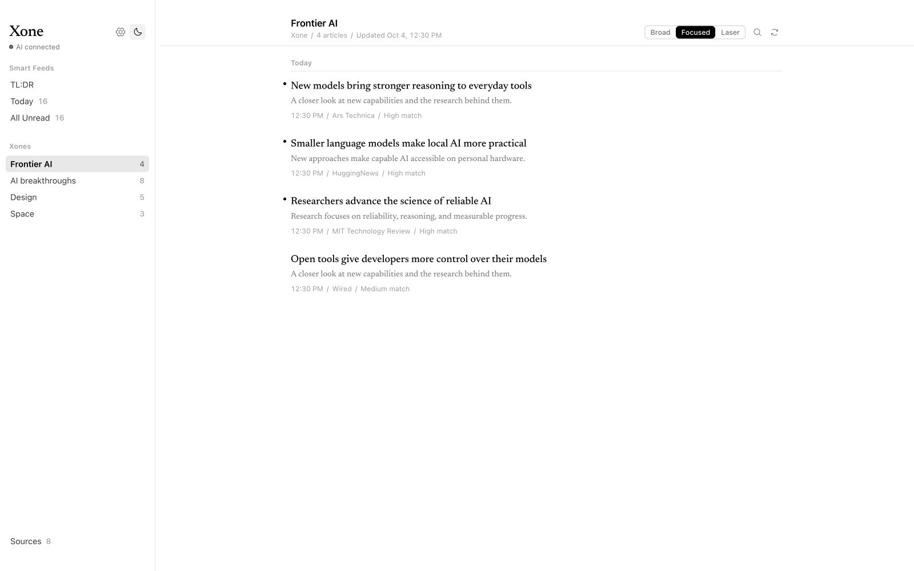

# Xone

**Less Feed. More Signal.**

An AI-powered information harness that turns the daily flood of news into focused insight. Define what matters in your Xone, choose your sources, and let Xone surface the stories worth your attention.

<!-- # github repo here: https://github.com/pkscanvas/xone -->
<!-- # weblink here: https://pkscanvas.github.io/xone/ (available after GitHub Pages deployment). -->
[Website](https://pkscanvas.github.io/xone/) · [Download for macOS](https://github.com/pkscanvas/xone/releases/latest/download/Xone_0.1.0_aarch64.dmg) · [GitHub](https://github.com/pkscanvas/xone) · [MIT License](LICENSE)



*Screenshots and videos use illustrative content.*

## Watch Xone

Watch both videos on the [Xone website](https://pkscanvas.github.io/xone/#product).

### The Xone film · 50 seconds

https://github.com/user-attachments/assets/ea361bc9-467c-4df3-8886-b2da64fd4b76


### Product walkthrough · 72 seconds

https://github.com/user-attachments/assets/e4aa62cf-0d62-45a1-a079-01dd0b9cf221

Product-demo music: “Open Spaces” by Hybridas on [Uppbeat](https://uppbeat.io/c/hybridas). Third-party media retains its own rights; the source-code MIT license does not license the soundtrack for separate redistribution.

## Start reading

1. Download `Xone_0.1.0_aarch64.dmg` using the download link above. This package is for **Apple Silicon Macs**.
2. Open the DMG and drag **Xone** into **Applications**.
3. Open Xone. If macOS blocks it, open **Apple menu → System Settings → Privacy & Security**, scroll to **Security**, and click **Open Anyway** for Xone. Follow the included **Read Me First** guide. The app is ad-hoc signed and is not notarized.
4. In **Settings → AI**, connect a local server or save your cloud provider's API key and model.
5. Start with **AI**, **Open Source AI**, and **Design**, or create a Xone with your own Signal brief.

Supply your own AI provider and model. No model or inference engine is bundled. Existing installations retain their own Xones and settings.

## Features

- **Your own Signal brief.** Write include/exclude criteria, sharpen them with AI, and get source recommendations.
- **494 configured sources.** Add custom RSS/Atom feeds and assign up to ten sources to each Xone.
- **Three starter Xones.** Fresh installs include AI, Open Source AI, and Design, each with eight sources.
- **Instant focus controls.** Broad includes low matches and above; Focused includes medium and high; Laser-focused includes high only. Switch without another model call.
- **Cited TL:DR.** Short briefings for each Xone covering the past 24 hours, with links to the original reporting.
- **Today and All Unread.** Read the stories admitted by your Xones in one place.
- **Related reports together.** Expand a story's report stack for other headlines and sources.
- **Learns from reading.** Every ten distinct attributed article opens refine a secondary profile; your Signal brief remains in charge.
- **Comfortable reading.** Light/dark themes, adjustable typography, and keyboard navigation.

Supported AI providers: **Ollama, LM Studio, OpenAI, Anthropic/Claude, Groq, OpenRouter**, and custom OpenAI-compatible servers.

## Roadmap

These are planned, not shipped:

- Decision-model support, such as Jev, for relevance filtering.
- A relevance model fine-tuned for Xone and bundled for faster filtering without external model setup. TL:DR prose would still need a generative model.

## Publish this project

See [PUBLISHING.md](PUBLISHING.md) for transferring the package to another computer, uploading the extracted source, creating the macOS release, replacing URL placeholders, and enabling GitHub Pages.

## Development

Install Node.js 22.12+ and Rust with the platform prerequisites for Tauri v2. On macOS, install Xcode Command Line Tools.

```sh
npm ci
npm run tauri -- dev
```

Checks:

```sh
npm run check
npm run build
cd src-tauri
cargo check
cargo test
```

The independent React/Vite website lives in `website/`. See [website/README.md](website/README.md).

## Apple Silicon release

```sh
bash scripts/package-macos-free.sh
```

To create the source ZIP with only public source and assets:

```sh
python3 scripts/package-source.py
```

The installer is written to `src-tauri/target/release/bundle/dmg/`. It contains an ad-hoc-signed app, an Applications shortcut, and a visible first-launch guide. It is not notarized. Follow the included Privacy & Security → Open Anyway instructions.

Upload the DMG to a GitHub Release, not the source tree. Enable GitHub Pages with GitHub Actions to deploy the website; its workflow fills in the current repository's links automatically.

## Data and credentials

The app creates its SQLite database in the operating system's application-data directory. Source code and installers contain public source metadata and the three starter Xone definitions, not the developer's database, API keys, articles, reading history, or learned profiles.

Provider keys are stored locally in SQLite, not in the system keychain. On macOS and Linux, the app restricts its data directory and database to the current user. Protect your application-data directory and backups. Cloud features send the relevant headlines, excerpts, briefs, and other required inputs to your selected provider. Local providers require a separately running local server.

Never commit `.env` files, databases, private keys, or local tool settings. Build output and local media workspaces are ignored. Scan source and final release artifacts before publishing.

## License

Xone source code is available under the [MIT License](LICENSE). Third-party dependencies and media retain their own licenses.
